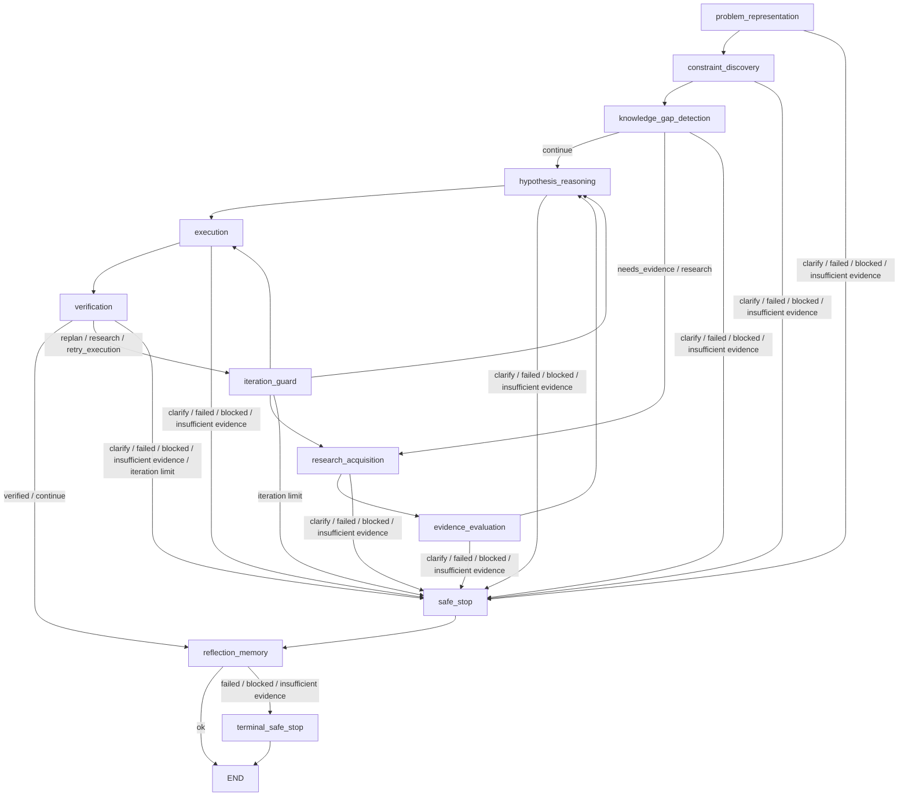

# Chapter 8 Graph Skeleton

Status: complete on `feature/chapter-8-graph-skeleton`.

Source of truth: `../../PolyaBrain_Product_Implementation_Master_Plan.md`

## Scope

Chapter 8 adds the first runnable LangGraph skeleton for the nine logical
PolyaBrain engines. It proves orchestration, recoverable routing, wrapper-owned
engine telemetry, event accumulation, safe stops, and iteration limits with
deterministic stub engines in tests.

This chapter does not add real engine intelligence, prompts, LLM calls, tool
execution, persistence, API endpoints, frontend screens, or report composition.

## Implemented

- Added `backend/app/graph/skeleton.py`.
- Added stable graph node names for all nine logical MVP engines:
  problem representation, constraint discovery, knowledge-gap detection,
  research acquisition, evidence evaluation, hypothesis reasoning, execution,
  verification, and reflection/memory.
- Added `PolyaGraphEngines` to require one `PolyaEngine` implementation per
  logical engine.
- Added `build_polya_graph` to compile the Chapter 8 LangGraph app.
- Added `run_polya_graph` to create initial state and invoke the skeleton.
- Added graph-owned `iteration_guard` and `safe_stop` router nodes.
- Added graph-owned `terminal_safe_stop` so reflection failures end audibly
  instead of routing back through reflection.
- Routed engine nodes through the Chapter 7 `run_engine` telemetry wrapper.
- Reconstructed graph route decisions from engine terminal event metadata
  instead of adding new first-class state fields.
- Added safe-stop behavior for missing input, blocked output, failed output,
  low-confidence clarification, insufficient evidence, and iteration exhaustion.
- Added backward/retry iteration counting for reframe, replan, retry execution,
  and verification-driven recovery routes.
- Defined `iteration_count` as total graph recovery passes, not per-route retry
  depth. It does not reset after successful recovery.
- Added lazy graph exports to avoid circular imports between graph state and
  engine contracts.
- Added Chapter 8 tests in `backend/tests/test_graph_skeleton.py`.

## Routing Diagram



## Routing Decisions

- Normal `ok/continue` output follows the forward Polya loop.
- `needs_evidence/research` routes to research acquisition.
- `needs_input/clarify` routes to safe stop and then reflection.
- `reframe`, `replan`, and `retry_execution` route through the iteration guard
  before returning to an earlier node.
- `failed`, `blocked`, and `insufficient_evidence` routes stop safely before
  reflection.
- Safe stops intentionally route to reflection when reflection can run, even if
  the stop happened early, so aborted or incomplete runs can still produce a
  minimal learning/audit artifact.
- Reflection is terminal only after successful reflection output.
- Reflection failure, blocked output, or insufficient evidence routes to
  `terminal_safe_stop` and then ends without re-invoking reflection.
- Terminal safe stop preserves any earlier safe-stop answer and appends the
  reflection-stage failure so the user-facing final answer does not hide terminal
  failures.

## Commands

```bash
make lint
make test
make proof
```

Chapter 8 does not require Docker/Postgres verification because it does not
change persistence.

## Verification Completed

- Graph compiles with `StateGraph(PolyaState)`.
- `"What is 2+2?"` runs through all nine deterministic stub engines.
- Wrapper events accumulate and expose every engine node in the trace.
- Knowledge gaps route to research before reasoning.
- Missing input stops safely before unrelated downstream engines run.
- Low-confidence, blocked, failed, and insufficient-evidence results do not
  continue blindly.
- Verification failure can route to replan, research, or retry execution.
- Iteration limits prevent infinite recovery loops.
- Reflection failures route to terminal safe stop without re-invoking
  reflection.
- Terminal safe stop surfaces reflection failure even when an earlier safe stop
  already wrote a final answer.
- Malformed engine output fails closed through the existing telemetry wrapper
  and safe-stop path.

## Deferred To Chapter 9

- Persist reasoning events in Postgres.
- Store route decisions as durable trace events.
- Add a session trace API endpoint.
- Add ordering tests against persisted trace records.
- Add secret-safety checks for stored trace data.

## Deferred Beyond Chapter 8

- Real engine implementations.
- LLM prompts and parser design.
- Tool registry, tool calls, approval flows, and risk enforcement.
- Solve-session API.
- Final report composer.
- Frontend rendering of graph state and trace.
