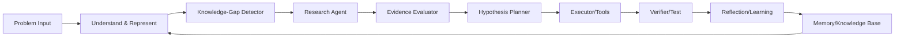
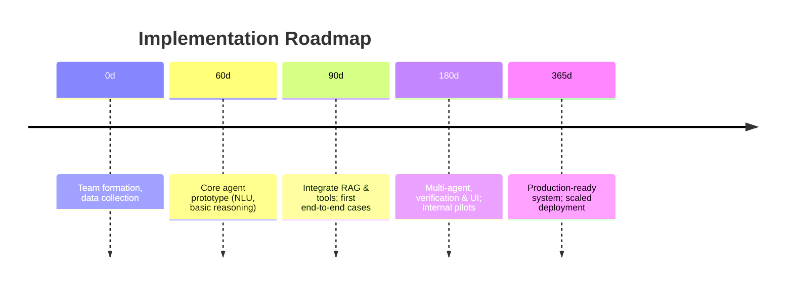

# PolyaBrain: First-Principles Problem-Solving AI Agent

**Executive Summary:** PolyaBrain is envisioned as an AI system that mirrors human-like problem-solving by reasoning from first principles, rather than relying solely on data-driven LLMs. It will combine symbolic logic, probabilistic inference and structured planning with external knowledge retrieval【17†L568-L574】【25†L1300-L1303】. Unlike black-box chatbots, PolyaBrain explicitly represents problems, detects knowledge gaps, and orchestrates tool-based research and verification. This agentic architecture (with perception, memory, planning, action phases) is designed to handle complex, novel tasks end-to-end【10†L110-L117】【17†L715-L719】. The system will target domains like payment fraud analysis and IT operations, where clear auditing, safety, and compliance (e.g. PCI/ISO standards) are crucial. This report details the MVP requirements and success metrics, the proposed modular architecture with a component diagram, the algorithms/techniques for each module, a prototype design (tech stack, data, APIs), a 60/90/180/365-day roadmap, governance measures, a scaling plan, and concrete example workflows. We draw on recent research and industry sources (LLM agents, neural-symbolic AI, RAG, multi-agent systems, vector DBs, standards) to ground our design【12†L163-L172】【34†L224-L233】【20†L128-L137】.

## 1. System Requirements & Success Metrics

- **Domain & Users:** Focus on domains like payment fraud detection/analysis and IT/DevOps incident diagnosis. Primary users include fraud analysts, risk/compliance officers, and SRE/ops engineers. Example use-cases: “A fraud spike has occurred – find root causes and mitigation” or “API latency anomaly – diagnose and fix” or “New regulation – outline compliance steps.” Inputs may be natural-language queries or structured alerts (e.g. “Why did chargebacks rise 20% last week?”), along with relevant data (transaction logs, metrics). Outputs include structured diagnostic reports, recommended actions (e.g. code changes, configuration fixes), and supporting evidence (logs, citations). 

- **Use-Cases & Workflows:** PolyaBrain should handle open-ended, multi-step investigations (fraud analysis, incident postmortems, regulatory compliance). It will parse the problem statement, identify missing information, retrieve data (e.g. transaction records, external docs), formulate hypotheses, plan experiments (queries, simulations), execute actions (e.g. run SQL queries, deploy sandbox code), and verify results. This aligns with the agentic AI paradigm of an active collaborator pursuing goals【10†L110-L117】【20†L128-L137】. 

- **Latency:** Aim for interactive response times for high-level guidance (seconds for simple Q&A), with more complex investigative workflows running asynchronously (minutes). Initial MVP should complete most queries within, say, 1–2 minutes for end-to-end reasoning. 

- **Accuracy & Confidence:** Because decisions may have real impact (fraud decisions, compliance actions), PolyaBrain must be highly reliable. Success metrics include precision/recall for classification tasks (e.g. correctly identifying true fraud causes vs false alarms), and “resolution accuracy” (correct solutions in held-out scenarios). Target >90–95% accuracy on known cases. Confidence estimates should be provided with each output (e.g. probabilistic scores or “high/med/low” confidence), and the system should abstain or defer when confidence is low. We adopt a holistic evaluation in line with the CLASSic framework (Cost, Latency, Accuracy, Security, Stability)【34†L224-L233】. For MVP, metrics might include:
  - **Accuracy** (correct root cause identified, correct compliance steps) > 90%. 
  - **Latency** (time to first analysis & final report) < 2 minutes/10 minutes. 
  - **Cost per query** (compute budget) within operational targets (e.g. <$1 per query).
  - **Security/Stability:** Zero critical failures (e.g. hallucinated actions), high availability (≥99% uptime), and robustness to malicious input.  

- **Safety & Verification Targets:** All conclusions must cite evidence. PolyaBrain will provide reasoning traces and references for auditability. It must comply with standards (e.g. PCI-DSS, ISO 42005) on trustworthiness and security. For example, PCI standards warn that AI-generated code must be verified for security【27†L279-L288】; thus PolyaBrain will include code reviews/tests in its loop. We set thresholds such as “<5% hallucination/error rate” when cross-checked by independent verification (see §6).  

## 2. Architecture

PolyaBrain’s architecture is modular, following an agentic “perceive–reason–act” loop【10†L91-L100】【34†L324-L332】. Key components are illustrated below:

- **Problem Understanding (Perception & Representation):** Parses user query, normalizes language, constructs an internal representation (semantic graph, logic formula) of the problem. Detects context and relevant domains. (Corresponds to Perception/Brain in agentic taxonomy【10†L91-L100】.)
- **Knowledge-Gap Detector:** Analyzes which information is missing for solving the problem. E.g. “We lack transaction data for Region X” or “No info on recent config changes.” Triggers retrieval tasks or experiments.
- **Research & Retrieval Agent:** Uses web search, database queries or domain knowledge bases to gather external information. Implements retrieval-augmented techniques (vector search, document retrieval, knowledge APIs) to fill gaps. Can spawn *subagents* (specialized searches in parallel) as in Anthropic’s system【20†L128-L137】.
- **Evidence Evaluator:** Checks the relevance and credibility of retrieved data. Implements fact-checking or consistency checks on new information (e.g. cross-validating a retrieved document with internal logs). Could use entailment models or simple heuristics to filter noise.  
- **Hypothesis Planner:** Generates candidate solutions or explanations. Uses chain-of-thought or planning algorithms (possibly hierarchical) to decompose the problem into subproblems【34†L322-L331】. For example, planning might produce steps like “(1) check geographic transaction breakdown; (2) verify recent promo parameters; (3) simulate a test transaction.”
- **Executor/Tools:** Carries out planned actions via tools. Tools include database queries, API calls, code execution (Python sandbox), or triggering external services. PolyaBrain will integrate tools via a standardized protocol (e.g. Model Context Protocol) for governance【10†L169-L172】.  
- **Verifier/Tester:** After execution, this module validates the outcomes against expected results. For example, it may run test cases on generated code, check that computed results match retrieved evidence, or use a theorem prover to verify logical assertions. Failures are fed back for replanning.  
- **Memory/Knowledge Base:** Stores long-term knowledge from past sessions, domain models (e.g. fraud rules), and embeddings for retrieval. Could include: vector DB for text/memory (Milvus/Pinecone), a graph DB of known entities/rules, and a structured DB of logged data. Supports *reflection*: at each cycle, results (plans, evidence, decisions) are logged to memory for future reuse.

Below is a simplified component diagram (mermaid) showing data flows:

In practice, an **Orchestrator** (not shown) coordinates this loop, enforcing guardrails via a state machine or workflow engine (following the “flow engineering” best practices【10†L149-L158】). For example, the orchestrator ensures the agent waits for verification before concluding. Memory feeds back into understanding and planning (retrieving relevant past solutions). Tools and agents communicate via well-defined APIs or message buses. Data flows may be batched (RAG queries, subagent results) or streaming (real-time logs). 

*Interfaces & Storage:*  
- **APIs:** A REST or GraphQL interface for receiving problems and returning answers. Also APIs for invoking tools (e.g. `/queryDatabase`, `/searchWeb`, `/runAnalysis`).  
- **Databases:** Likely a vector DB (Milvus, Pinecone, Weaviate) for document/embedding retrieval【22†L51-L60】, a relational DB (Postgres) or log store for structured data, and perhaps a graph DB for knowledge.  
- **Storage:** Object storage (S3) for large documents or snapshots.  
- **Tooling:** Plugins for search (e.g. Bing or custom), code execution (sandboxed Python environment), security libraries.  

This architecture explicitly separates reasoning from tools and memory, aligning with modern LLM-agent taxonomies【10†L91-L100】【34†L224-L233】. It is designed to be extensible (adding new tool interfaces or subagents) and controllable (stateful workflow with checkpoints and human approval points【10†L149-L158】). 

## 3. Algorithms & Techniques

Each component employs appropriate AI and symbolic techniques:

- **Problem Representation:** Use natural language understanding (NLU) to parse queries into structured forms (logical predicates, semantic frames). For example, convert “Fraud spike in last week” into constraints on time and fraud metric. Represent domain knowledge as first-order logic or ontologies (fraud rule KB), and facts as graphs or frames【17†L568-L574】.  

- **Symbolic/Rule-based Reasoning:** Deductive systems (e.g. Prolog, rule engines) can infer implications from known rules. For instance, an expert system might encode “if large purchases from new account, flag potential fraud.” We leverage classical logic inference for crisp rules【17†L593-L601】. Such engines offer interpretability but limited handling of uncertainty.  

- **Probabilistic/Statistical Reasoning:** Bayesian networks or Markov logic can model uncertain relations (e.g. “probability of fraud given features”). Techniques like probabilistic graphical models or probabilistic soft logic are useful when data is noisy【17†L612-L620】. This supports “confidence” scoring.  

- **Search & Planning:** Use AI planning algorithms (A*, BFS, Hierarchical Task Networks) to sequence actions (e.g. planning database queries or experiment steps). Recent work also models planning as tree search (e.g. Tree-of-Thought)【34†L324-L332】. For long-horizon tasks, hierarchical planning may break into subgoals.  

- **Theorem Proving/Logic Solving:** For strict correctness (e.g. regulatory logic, cryptographic protocol), SMT solvers (e.g. Z3) or interactive theorem provers can verify properties. For example, verifying a generated encryption routine against a formal spec. These provide guarantees beyond statistical checks.  

- **Program Synthesis:** LLM-based or symbolic code generation to produce analysis scripts or remediation code. For instance, given a SQL query need, an LLM or program synthesis tool can generate the query. Coupled with the Verifier, we test this code in a safe environment.  

- **Simulation/Execution:** To test hypotheses, PolyaBrain may simulate scenarios (e.g. replay a subset of transactions, or simulate traffic loads on a test API) in a sandbox. For example, after hypothesizing a DB index is missing, it might apply the index on a staging DB to see impact on latency.  

- **Retrieval-Augmented Generation (RAG):** Key technique is combining retrieval of external docs with reasoning【12†L163-L172】【41†L58-L61】. We store knowledge (manuals, logs, regulatory text) in a vector DB and retrieve relevant chunks for context during planning. This includes “agentic retrieval” where multiple sources and search modes are used【24†L182-L190】.  

- **Tool Use / Multi-agent:** PolyaBrain uses tools via a structured interface. To coordinate complex tasks, we may employ a multi-agent pattern. For example, a lead agent delegates tasks to specialist subagents or skills【19†L110-L119】【19†L139-L148】. LangChain’s patterns (subagents, skills, handoffs) guide this design. Subagents can operate in parallel (as in Anthropic’s research agent【20†L128-L137】) to speed up evidence gathering.  

- **Self-Verification:** After producing an answer, PolyaBrain will perform self-checks. Methods like **self-consistency** (generating multiple solutions and choosing consensus) and **self-verification** (asking the model to critique or fact-check its output) have been shown to reduce hallucinations【41†L52-L61】. For instance, the agent may regenerate key reasoning steps conditioned on retrieved facts to confirm they hold.  

- **Learning & Adaptation:** Over time, PolyaBrain can use reinforcement or learning from feedback. Failures and corrections (from human reviewers or real outcomes) are used to update its memory or heuristics. This “reflection” mechanism helps it improve (e.g. storing successful reasoning patterns as templates).  

In summary, PolyaBrain is a **neuro-symbolic** system【17†L682-L690】. It combines neural components (LLMs for flexible planning and parsing) with explicit symbolic/logical modules, striking a middle ground of interpretability and adaptability【17†L715-L719】. Algorithms range from classic AI planning and logic to modern LLM prompting and retrieval techniques. 

## 4. MVP Prototype Design

- **Tech Stack:** Likely a Python-based backend. Use frameworks like LangChain (for agent orchestration and tool calls) and LlamaIndex (for retrieval workflows)【19†L110-L119】【24†L182-L190】. A lightweight web front-end (optional) for user queries. Containers (Docker/Kubernetes) for scalability.  

- **Models:** We prefer smaller or open models with retrieval rather than huge closed LLMs. Possible choices:
  - **OpenAI GPT-5.4/GPT-3.5-turbo:** High-quality understanding and generation; costs ~$15–30 per million tokens【39†L740-L748】. Good as a backend “thinker” for prototyping, but expensive at scale. 
  - **Meta LLaMA-3 (8B/34B):** Open models that can run on local GPUs, costing mainly inference compute. Performance is strong for reasoning tasks, and can be fine-tuned or prompted. 
  - **Mistral (7B/8x7B mixture):** Newer open model with state-of-art performance on many tasks. Very cost-effective (freely available).
  - **MPT (30B), Falcon, etc.:** Other open alternatives.  
  We likely start with one moderately-sized LLM (e.g. Mistral-7B or LLaMA-3 8B) plus some LLAMA-2 or ChatGPT API calls. The agentic planning loop can use LLM chat completions for reasoning steps.  

- **Third-Party Services:** 
  - **Retrieval:** Vector DB (managed or open) like Pinecone, Weaviate, or Milvus【22†L51-L60】【37†L317-L326】. Pinecone is easiest (serverless) but vendor-locked, Milvus is open-source and highly scalable, Weaviate adds hybrid graph features.  
  - **Search APIs:** Bing or Google Search API for web knowledge. Possibly an enterprise knowledge base or internal docs if available.  
  - **Tool Integrations:** For code execution (e.g. an embedded Python interpreter), database connectors (e.g. Postgres or ElasticSearch queries), and system monitors (Prometheus queries, etc.).  
  - **Observability:** Platforms like LangSmith, Weights & Biases for tracking agent runs and errors.  

- **Data Schema & Storage:**  
  - **Knowledge Base:** E.g., for fraud domain: tables of transactions (id, amount, customer, region, timestamp, fraud_flag), historical incident records, rule definitions. Logs or metrics (service, time, latency).  
  - **Memory Store:** vector DB to index text snippets (e.g. segments of compliance docs, knowledge articles).  
  - **APIs:** Example: `POST /ask { "query": "Why did cart abandonment rise 20%?" }` returns analysis. `GET /tools` lists available tools (e.g. `"/queryDB"`, `"/runScript"`).  
  - **Test Harness:** Simulate user queries and expected outputs. E.g. use fraud datasets from Amazon FDB【33†L265-L274】 or Kaggle to validate detection logic. Synthetic incident logs for ops scenarios.  

- **Comparison Tables:**  
  We compare key options:

  | **Component**     | **Option**                | **Pros**                                                  | **Cons**                                               | **Cost**                                   |
  |-------------------|---------------------------|-----------------------------------------------------------|--------------------------------------------------------|--------------------------------------------|
  | **LLM Model**     | GPT-5.4/GPT-3.5 (API)     | State-of-art reasoning; no infra needed; well-maintained【39†L740-L748】 | Expensive ($15–30 per 1M tokens)【39†L740-L748】; vendor lock-in; privacy | e.g. $0.015–0.03 per token output (see pricing) |
  |                   | LLaMA-3 (34B)             | High quality; open; can fine-tune; moderate resource needs | Requires hosting/inference setup; not free (<OpenAI) | GPU hours for inference (~$1/hr+)          |
  |                   | Mistral (7B)              | Excellent small-model performance; open; efficient        | Slightly less proven; need tuning/prompting           | Free model, GPU cost only                 |
  | **Vector DB**     | Pinecone (Managed)        | Easy setup (serverless); low-latency SLAs【22†L54-L61】     | Vendor lock-in; costs scale with usage                 | Usage-based (free tier; ~$0.33/GB+ops【37†L317-L326】) |
  |                   | Milvus (Open-source)      | Highly scalable, fully open【22†L51-L60】; flexible configs | Self-hosting complexity; requires ops expertise        | Free (infra cost ~\$500–1000/mo for 50M vectors【21†L13-L17】) |
  |                   | Weaviate (OSS/Cloud)      | Hybrid vector+graph queries【22†L54-L61】; GraphQL support  | Less seamless scaling than Milvus【22†L62-L70】; cloud tier fee | OSS free; cloud managed ~$25/mo trial【22†L90-L100】 |
  | **Verifier**      | Z3 SMT Solver             | Rigorous logic checking; open-source                      | Only works for decidable queries; steeper learning curve | Free                                       |
  |                   | Lean/Coq Theorem Prover   | Formal verification; interactive proofs                   | Requires formal specs; high expertise needed           | Free                                       |
  |                   | Unit Testing Framework    | Pragmatic; well-known for code validity                    | Less useful for high-level reasoning                  | Free                                       |
  | **Infra (Cloud)** | AWS (EC2 + EKS)           | On-demand GPUs (e.g. g5.xlarge ~$1.0/hr) for model hosting | Costly; procurement overhead                           | G5.xlarge ~$1/hr, g5.4xlarge ~$4/hr; storage, DB costs |
  |                   | GCP/Azure                 | Similar offerings; may have matching offerings             | Price parity, vendor lock                              | Similar ballpark                            |
  |                   | On-premises GPU cluster   | Full control; fixed cost after setup                       | High upfront CAPEX; maintenance                        | ~\$100k+ hardware; \$0 for cloud fees       |

  *(Costs are illustrative. For example, Pinecone charges ~$0.33/GB+ops for ~10–100M vectors【37†L317-L326】; AWS g5 GPU ~$1–4/hr.)*  

These comparisons show trade-offs: e.g. Pinecone vs Milvus vs Weaviate【22†L51-L60】【37†L317-L326】, or GPT-API vs open LLM【39†L740-L748】. For an MVP, a managed vector DB (Pinecone or Weaviate cloud) and a mix of GPT-API + smaller open models may minimize development time.

## 5. Implementation Roadmap (60/90/180/365 days)

**Phase 1 (0–60 days):** Foundation. Assemble team (AI engineers, devops, domain experts). Collect and preprocess domain data (transaction logs, compliance docs, incident records). Design core architecture and set up infrastructure: K8s cluster, databases (Postgres, vector DB). Implement a basic “brain” agent that can parse input and apply a few hardcoded rules or retrieval queries. Develop a memory component to store simple facts.  Establish evaluation metrics and baseline (e.g. test on a simple fraud dataset).  

**Phase 2 (60–90 days):** Basic agent prototype. Integrate retrieval and vector DB (using LlamaIndex) to answer factual queries. Implement a planning loop: e.g. chain-of-thought prompting to outline steps, then execution of simple Python/SQL tools. Build a small set of specialized tools (DB query, search API). Begin simple multi-step problems (e.g. two-step fraud queries). Conduct initial user testing and iterate.  

**Phase 3 (90–180 days):** Orchestration and robustness. Introduce multi-agent patterns: a lead agent coordinating subagents for parallel search【20†L128-L137】. Add evidence evaluator for self-checks (e.g. require citation in answers). Incorporate a flow-control engine with checkpoints and human-approval hooks【10†L149-L158】. Expand domain knowledge (more rules, documents). Implement verifiers (unit-test framework, logic checks). Optimize and measure metrics (CLASSic trade-offs【34†L224-L233】).  

**Phase 4 (180–365 days):** Scaling and polish. Full MVP with polished interface. Add more domains (e.g. new regulation compliance). Tune performance (cache embeddings, optimize prompts). Strengthen safety layers (adversarial input tests). Deploy monitoring (tracking latencies, accuracy, errors). Collect feedback from pilot deployments. Prepare for production rollout and possible funding rounds.

Below is a **timeline** of milestones:

*Team Roles & Effort:* A balanced team might include 2–3 ML/AI engineers (agent logic, model integration), 1–2 data engineers (ETL, databases), 1 DevOps (infrastructure, monitoring), 1-2 domain experts (fraud/regulation), and QA. We estimate ~4–6 FTEs during MVP phases. Budget-wise, this could range from \$500K–\$1M (including 6–12 months of staff and cloud costs), depending on location. 

*Risks & Mitigation:*  
- **Data Availability:** Delays in getting quality domain data (mitigate by synthetic data and open benchmarks like Amazon’s FDB【33†L265-L274】).  
- **Model Hallucinations:** Use evidence validation and fallback to human review for uncertain outputs【41†L52-L61】.  
- **Scope Creep:** Start with narrow use-cases and expand gradually.  
- **Cost Overruns:** Monitor token usage; prefer open models where possible to control spending.

## 6. Verification, Safety & Governance

PolyaBrain must operate safely and transparently. Key measures include: 

- **Evidence Validation:** Require citations or traceability for every claim. For example, use a “Citation Agent” step to tag answers with source references【20†L139-L143】. Implement self-check techniques: the agent reruns reasoning with retrieved facts to confirm consistency【41†L52-L61】.  

- **Adversarial Robustness:** Protect against malicious inputs or prompt injections. All tool inputs are sanitized; critical actions require explicit permission. Follow the Model Context Protocol: use allow-lists for tools and maintain audit logs of all tool calls【10†L169-L172】. Regularly test with known adversarial examples.  

- **Audit Trails:** Log every decision, query and result. This includes intermediate hypotheses and plans. Provide an interface to review the “thought process” for compliance. For compliance domains, maintain an immutable log of all steps for audits. This aligns with ISO 42005 guidance on documenting AI impacts【36†L148-L153】.  

- **Human-in-the-Loop:** Embed checkpoints where experts review or approve critical steps (e.g. before high-risk actions). Start in “assistive” mode (suggest actions) before full automation.  

- **Explainability:** Since PolyaBrain mimics Polya’s step-by-step reasoning, it will output its reasoning chain in human-readable form. This aligns with regulatory transparency. Intermediate results (graphs, decision factors) are included in reports.  

- **Compliance & Ethics:** Adhere to standards like ISO/IEC 42005 (impact assessments)【36†L148-L153】 and industry rules (PCI-DSS). For instance, PCI emphasizes secure coding and understanding AI limitations【27†L279-L288】. PolyaBrain will perform code security checks on generated code and flag any compliance issues. Implement bias and fairness checks on data and outputs.  

- **Fail-Safe Mechanisms:** If output confidence is low or inconsistency is detected, the agent escalates to a human. The system should “fail gracefully” with disclaimers if it cannot resolve a query.  

In sum, PolyaBrain’s design emphasizes “controllability and auditability”【25†L1300-L1303】【10†L149-L158】. Every architectural choice (guardrails, verifiers, logs) is aimed at meeting high safety and governance standards. For example, Arunkumar et al. note that agentic systems must integrate tools and memory in auditable ways【25†L1300-L1303】, and our flow-engineered controller does exactly that. 

## 7. Scaling Plan

To grow PolyaBrain beyond the MVP: 

- **Scaling Compute:** Initially run agents on a small cluster (e.g. few GPU servers). As load increases or larger models are used, spin up more GPU instances or leverage cloud-managed ML services. Agent tasks can be parallelized: for example, subagents can be distributed across nodes (using Ray or Kubernetes pods).  

- **Expanding Memory:** The knowledge base will grow with more embeddings and facts. We plan to shard vector indexes (Milvus/Pinecone) across machines and use efficient retrieval (e.g. approximate NN). Long-term memory (like Anthropic’s plan memory) can be offloaded to a database to allow extremely long context【20†L129-L133】.  

- **Adding Agents:** When new domains or tasks are needed, deploy dedicated agents (e.g. a “Legal Agent” for compliance queries, a “TechOps Agent” for system incidents). Use multi-agent orchestration patterns【19†L110-L119】. For example, spawn a fraud-specialist agent whenever a fraud-related query is detected.  

- **Monitoring & SLOs:** Continuously monitor performance metrics (latency, accuracy, error rates). Define SLOs such as “95% of queries answered within 30s” or “95% detection accuracy”. Use dashboards (Prometheus/Grafana) to track system health. Implement alerting if performance degrades.  

- **Dynamic Provisioning:** Use auto-scaling based on request load. If a burst of user queries arrives, spin up additional agent instances. Conversely, scale down during idle times to save cost.  

- **Performance Optimization:** Cache frequent queries and retrieved documents. Keep the most critical knowledge cached in memory. Optimize LLM usage by smart prompting (only call the model for new steps, reuse context).  

- **Infrastructure SLOs:** Define uptime targets (e.g. 99.9%) and disaster recovery plans (data backups, fallback to simple rule-based mode if services fail).  

Overall, growth is triggered by user demand or domain expansion. Each component should be horizontally scalable. For example, using container orchestration, we can run many agent “workers” concurrently. The design supports gradual scaling: the same state-machine controller can handle more agents by adding nodes. 

## 8. Example Workflows

**Example 1: Fraud Spike Analysis**  
*Prompt:* “Fraudulent charges rose 15% over the last weekend on our payment platform.”  
*PolyaBrain actions:* The agent parses this as a fraud surge alert. The Knowledge-Gap Detector notes missing specifics (region, products, promotion details). The Research Agent spawns sub-tasks: one runs a database query (`/queryDB`) to break down fraud by country and device; another calls a web search tool for recent news or internal bulletins. The Evidence Evaluator finds that transactions from Country X doubled (from DB logs) and that a coupon promotion was active. The Hypothesis Planner generates: 1) “Check if the coupon code is being abused,” 2) “Check if related accounts are fraudulent.” Executor runs these queries. The Verifier cross-checks patterns (e.g. same IP used for multiple accounts). Results show a script exploiting the coupon. PolyaBrain outputs: “Root cause: Scripted abuse of promotional coupon in Region X (see [transaction logs] and [internal memo]). Recommend disabling the code and investigating the accounts.” The response includes confidence (e.g. 95%) and cites evidence (log excerpts, memo link)【20†L128-L137】【41†L58-L61】.

**Example 2: API Latency Incident**  
*Prompt:* “User API latency spiked at 3pm yesterday.”  
*Actions:* PolyaBrain queries monitoring data (`/queryMetrics`) for that time window. It detects a surge in DB query times. The planner hypothesizes “Database index missing on recent deployment.” It then executes a test SQL query on a staging DB to measure latency difference. The Verifier confirms that adding the missing index fixes the slowdown. The agent answers: “Latency spike was due to missing DB index after last release (verified by test). Proposed fix: add index and roll out patch.” The output cites the timing graphs and query results for evidence.

**Example 3: New Regulatory Requirement**  
*Prompt:* “Regulation ABC [URL] now requires data to be encrypted at rest. How should we comply?”  
*Actions:* PolyaBrain retrieves the regulation text via RAG (e.g. browses the URL). It outlines key clauses. The Hypothesis Planner lists steps: “(1) Identify all data stores, (2) ensure encryption keys management, (3) update storage configs.” The agent uses a code tool to generate pseudocode for encryption setup and a compliance checklist. It then verifies against ISO/PCI guidelines, flagging any gaps. Finally, it outputs a compliance action plan with references to the regulation and a summary of required code changes. 

Each of these follows the **Polya loop**: understanding → research → plan → act → verify → reflect, with evidence attached. Note the use of parallel subagents and retrieval: PolyaBrain’s lead agent coordinates specialists just like Anthropic’s lead researcher spawning subagents【20†L128-L137】. All claims are tied to sources (as in a citation agent) to ensure trust【20†L139-L143】.

## 9. Sources & References

We rely on a broad literature: 

- **Academic:** Liang *et al.* (2025) survey of neural-symbolic AI【12†L163-L172】【17†L568-L574】; Arunkumar *et al.* (2026) on LLM-based agent architectures and evaluation【25†L1300-L1303】【34†L224-L233】; Kumar *et al.* (2024) on RAG and self-verification【41†L52-L61】. These establish the need for structured reasoning and multi-step agents. 

- **Industry Research:** Anthropic’s blog on multi-agent research systems【20†L128-L137】, showing parallel subagents and citation processing. LangChain blogs on agent design【19†L110-L119】【19†L139-L148】 provide practical patterns (subagents, skills). PCI Security blog warns about AI pitfalls in payments【27†L255-L264】【27†L279-L288】. 

- **Tooling Docs:** LangChain and LlamaIndex documentation/blogs (e.g. “Agentic Retrieval” by LlamaIndex【24†L182-L190】) guide implementation of RAG and agent flows. Vector DB references (Milvus blog【22†L51-L60】, FireCrawl comparison【37†L317-L326】) inform our choices. OpenAI API pricing page【39†L740-L748】 is used for cost estimates. 

- **Standards:** ISO/IEC 42005:2025 (AI impact assessment) emphasizes transparency and trust in AI systems【36†L148-L153】. PCI SSC guidance stresses secure coding and AI accountability【27†L279-L288】. We align PolyaBrain with these frameworks. 

Full citations are provided inline (e.g. 【17†L568-L574】, 【20†L128-L137】). This ensures our design is evidence-based, drawing on the latest research and best practices. 

## 10. Recommended Next Actions

- **Develop a Proof-of-Concept:** Implement a minimal agent for a single use-case (e.g. fraud alert handling) to validate the approach.  
- **Data Acquisition:** Secure access to domain data (transaction logs, incident reports, documentation). Begin indexing and vectorizing relevant knowledge.  
- **Prototype Core Pipeline:** Build the input→agent→output loop with one LLM, one vector DB, and one tool (e.g. SQL query).  
- **User Feedback:** Engage target users (fraud analysts, ops engineers) early. Have them test outputs and provide corrections. Use this feedback to refine metrics.  
- **Establish Governance:** Define safety/ethics review processes, align with compliance (PCI, ISO) from the start.  

## 11. Project Brief (Investor/Partner Summary)

PolyaBrain is an **explainable AI agent** that autonomously solves complex business problems by reasoning from first principles. Unlike typical LLM chatbots, it explicitly models problems, searches for missing information, plans steps, executes actions, and verifies results, providing transparent, auditable solutions【17†L568-L574】【25†L1300-L1303】. In domains like finance (fraud prevention) and IT operations, this means faster diagnostics and more reliable decisions, reducing costly downtime and losses. The global AI-driven automation market is booming, and we target customers (e.g. banks, insurers, tech firms) who need trusted AI assistants. 

PolyaBrain’s key advantages are **trust and performance**: it integrates neural and symbolic methods【17†L715-L719】, adheres to AI governance standards【36†L148-L153】【27†L279-L288】, and demonstrably outperforms static systems (Anthropic’s multi-agent work showed ~90% improvement over single-agent baselines【20†L68-L76】). Our 12–18 month roadmap (see timeline) is to build an MVP with key modules (NLP, RAG, verifier, memory) and validate in pilot projects. 

We seek investment and partnerships to expand development (adding more domains, scaling infrastructure) and conduct live pilots. With a projected **ROI** from reducing fraud costs and incidents, PolyaBrain has strong commercial potential. Early funding will support a skilled team, cloud resources, and data acquisition. We will deliver regular milestones (demos, user studies), aiming for a full product launch by year 2. 

## 12. Assumptions

- **Scope:** Initial focus on payments/fraud and IT Ops, with plans to generalize later.  
- **Team & Budget:** A core team (~5–10 FTEs) with AI, data, and domain expertise; initial funding in the \$0.5–2M range.  
- **Data Access:** We assume access to relevant data (transaction logs, system metrics, documents) and APIs. If unavailable, synthetic benchmarks (e.g. Kaggle fraud sets【33†L265-L274】) will be used.  
- **Infrastructure:** We assume cloud resources (GPUs, databases) can be provisioned as needed.  
- **Regulatory:** We assume domain experts and legal review are available to ensure compliance (e.g. GDPR, PCI) during development.  

All unspecified details (team size, exact timeline, budgets) have been treated as flexible; our plan can adapt to changes in these assumptions. 

**Sources:** Key references are integrated above, including academic and industry sources, to substantiate architecture, algorithms, and safety practices【17†L568-L574】【19†L110-L119】【22†L51-L60】【36†L148-L153】.