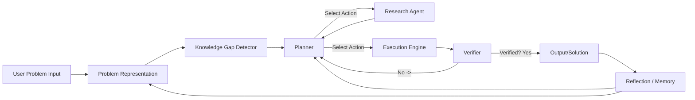
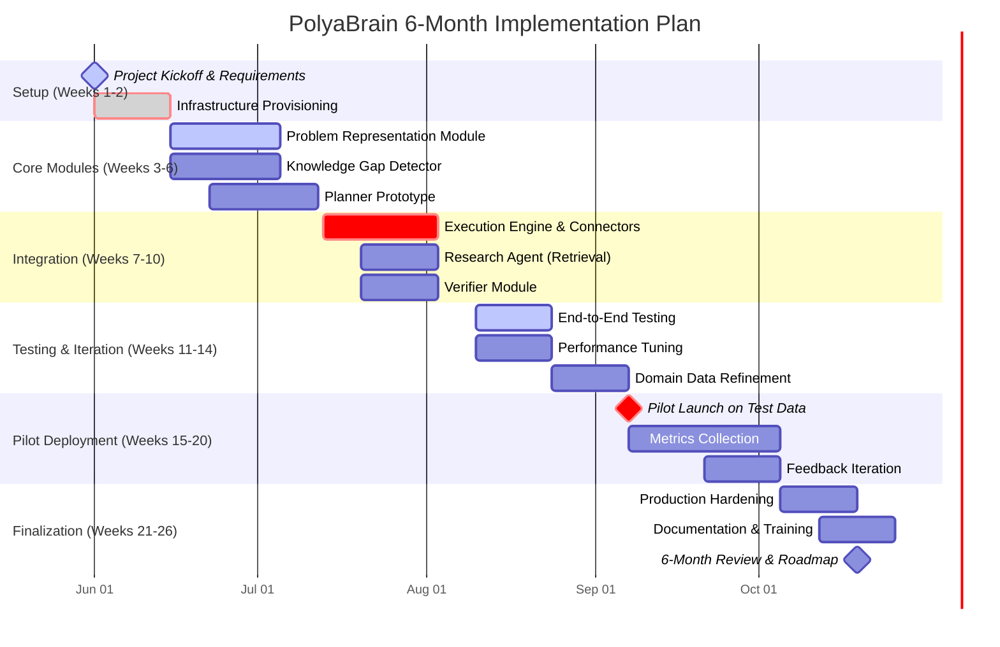

# Executive Summary

PolyaBrain is a **modular, reasoning-first AI system** inspired by George Pólya’s four-step problem-solving method (Understand, Plan, Execute, Reflect).  It combines large language models (LLMs) with external tools (retrievers, databases, execution engines) in a **cognitive-architecture style design**【16†L107-L115】【26†L157-L165】. Rather than relying on a single massive model, PolyaBrain treats intelligence as a system design problem (akin to human cognition【16†L107-L115】) and uses LLMs as “conductors” orchestrating specialized modules【35†L52-L60】【26†L157-L165】. This approach aligns with the emerging **Compound AI Systems (CAIS)** paradigm: modular architectures that integrate models, memory, planning and tool-use【26†L157-L165】.  

Importantly, PolyaBrain’s core idea is **not entirely new**. Early AI projects like the *General Problem Solver* (GPS) in the 1950s already attempted human-like planning and means–ends analysis【18†L100-L104】【20†L127-L135】. Modern “agentic” AI research (e.g. LangChain, AutoGPT, Amazon Bedrock Agents) likewise embodies multi-agent, planning-based architectures【26†L168-L175】【35†L89-L97】. However, PolyaBrain’s specific emphasis on explicitly framing problem-solving in Pólya’s terms, **detecting knowledge gaps**, and **iteratively verifying solutions** may be novel. By integrating first-principles reasoning, active information retrieval, and continuous self-reflection (memory), PolyaBrain aims to reduce hallucination and improve robustness compared to monolithic LLM pipelines【26†L148-L156】【35†L89-L97】.

We recommend focusing the 6-month implementation on a **single vertical (“wedge”)** for maximum impact and feasibility. A promising choice is **payments/fraud investigation** (e.g. analyzing anomalous transaction spikes, chargeback patterns, or fraud attacks). This domain fits PolyaBrain’s strengths: problems are well-defined yet complex, require multi-step reasoning (data queries, hypothesis testing), and have high business value (fraud costs are huge, and improving detection saves money and time【43†L230-L238】).  

The plan below outlines a detailed roadmap to build PolyaBrain as an MVP system for fraud analysis. Key sections include goals & metrics, MVP scope, architecture, modules, tech stack, deployment, testing, timeline (with Gantt chart), team roles, budget, risk analysis, and prior-art review. We include tables comparing technology options and cite relevant research and industry sources throughout【16†L107-L115】【26†L157-L165】【35†L89-L97】.

# Goals and Success Metrics

- **Primary Goal:** Build a prototype PolyaBrain system that **understands and solves complex problems in the fraud/payments domain** by emulating human problem-solving steps. For example, given a spike in declined transactions, the system should identify root causes (e.g. gateway issues, fraud attack vectors) and suggest corrective actions.  
- **Secondary Goals:** Enable the system to *explain its reasoning process*, *identify missing information*, and *self-correct* if an initial hypothesis fails. The system should log “lessons learned” for future problems (reflection).  
- **Success Metrics:**  
  - *Solution Accuracy:* Percentage of incidents correctly diagnosed (vs. known ground truth). Use precision/recall or F1 on labeled test cases (e.g. simulated fraud events).  
  - *Time to Resolution:* How quickly PolyaBrain reaches a solution versus a baseline (human analyst or rule-based system). Measure end-to-end latency.  
  - *User Satisfaction:* Qualitative rating by fraud analysts (feedback on usefulness, trust).  
  - *Resource Utilization:* LLM API calls, cloud compute hours per incident (cost efficiency).  
  - *Robustness:* Rate of hallucinations or false conclusions (should be minimal, as PolyaBrain verifies facts).  
- **Key Performance Indicators (KPIs):** For a pilot, we might set targets such as **≥80% correct root-cause identification**, **<2 min average decision time**, **>90% analyst acceptance**. These benchmarks should be refined after initial testing.  

# MVP Scope and Vertical Focus

We recommend a **single-domain MVP** to prove the concept. Given the user’s expertise in payments and fraud, and the urgent need in industry, we propose **PolyaBrain-Fraud (Payment Operations Intelligence)**. In this scope:

- **Use Case Example:** An unexpected surge in transaction declines or chargeback rates occurs. PolyaBrain analyzes system logs, transaction data, and external news/sources to identify if it’s due to a merchant outage, a new fraud pattern, network error, etc. It then generates an investigation plan (e.g. "Check BIN-level declines, verify gateway status, review recent fraud rules") and executes it.  
- **Justification:** Financial fraud detection is a high-impact problem where AI is increasingly applied【43†L230-L238】. Automating investigative reasoning can **save analysts time, reduce false positives, and catch novel fraud** faster. Existing solutions often use static ML models; PolyaBrain adds reasoning and adaptability.  
- **Boundary:** Initially focus on **card-not-present payment fraud, chargebacks, and declines** within one region/country. Assume access to transaction database, fraud rule engine logs, and internal monitoring metrics. Regulatory context (e.g. PCI compliance) and data privacy constraints (anonymized PII) are considered as constraints.  

# Prioritized Feature Backlog

We organize features roughly by Polya steps and system components. High-priority items for the MVP (weeks 1–12) include:

1. **Problem Input & Representation**:  
   - Develop a structured schema (JSON) for incoming problems (e.g. spike event: time, metric, magnitude, context).  
   - Implement a *Problem Parser* that fills in: *objectives* (e.g. “identify cause of 30% decline increase”), *constraints* (e.g. time-window, regulatory limits), *knowns/unknowns*.  

2. **Knowledge Gap Detection**:  
   - Build logic (or LLM prompts) to identify missing data needed (e.g. “We lack issuer category data”).  
   - Connect to metric stores (Prometheus, CloudWatch) to fetch key system stats (latency, error rates). Flag “unknowns” for which to trigger search.  

3. **Planner (Hypothesis Generator)**:  
   - Implement a Planner module: either rule-based or LLM-assisted. It should produce a ranked list of **hypotheses or investigation steps** (e.g. network outage, fraud rule issue, internal bug).  
   - Initially encode basic heuristics (e.g. “if decline spike and 3D secure errors spiked, suspect gateway issue”).  
   - Allow LLM to suggest novel possibilities via chain-of-thought prompting【35†L89-L97】【36†L85-L94】.  

4. **Data Retrieval & Tool Execution**:  
   - Create connectors to core data sources: SQL database (transactions), logs (Elasticsearch/Kibana), fraud rule engine API, payment gateway status API, etc.  
   - Develop an *Execution Engine* that runs queries or calls tools. For example, “Query database for decline rates by merchant, card-issuer, geo.” Use Python or Java services.  

5. **External Research Agent**:  
   - Integrate web search or news APIs (e.g. Google/Bing API) to fetch relevant context (e.g. recent fraud trends, merchant outages).  
   - Use a vector database to index domain knowledge (fraud patterns, regulations) and retrieve relevant articles on demand.  

6. **Verifier Module**:  
   - Implement checks on each hypothesis: e.g. cross-validate with data (“Does IP velocity suggest bot attack?”), test consistency (“Are the timelines aligned?”).  
   - Use LLM or rule-based QA to evaluate evidential support. If evidence contradicts the hypothesis, mark it for re-planning.  

7. **Memory/Reflection**:  
   - Store outcomes of incidents and solutions in a knowledge base.  
   - After solving each case, update a “Lessons Learned” log (e.g. “Commerce API unavailability causes 3% drop each Friday” or “Fraudster use X pattern”).
   - Schedule periodic re-planning if previous actions did not fully resolve the issue.  

8. **User Interface / Interaction**:  
   - (MVP low priority) Provide a simple UI or messaging interface (Slack bot, web UI) for an analyst to present the problem and receive the plan/results.  

9. **Monitoring & Feedback**:  
   - Instrument metrics on PolyaBrain’s performance (response time, success rate).  
   - Build analytics dashboards (Grafana, Kibana) to track progress against KPIs.  

Each feature will be broken into smaller tasks in the 6-month timeline (below). Early sprints focus on designing the architecture and core modules (Representation, Planner, Data Connectors). Later sprints focus on integration, verification, iteration, and domain-specific refinement.

# System Architecture

PolyaBrain’s architecture is **modular** and **actor-oriented**, as shown below. A top-level orchestrator (in Java/Spring Boot) coordinates the flow between components. Each box below represents a service or module; arrows indicate data flow.

**Figure:** High-level architecture of PolyaBrain. The “Problem Representation” and “Knowledge Gap Detector” parse input. The “Planner” decides next steps, which can involve either the “Research Agent” (external search/knowledge) or the “Execution Engine” (query DB, call APIs). Results flow into the “Verifier” (checks consistency), which loops back to the Planner if needed. Final output goes to the analyst and is logged in “Reflection/Memory” for future learning. The orchestrator enforces the sequence and handles state.

Each module has a clear interface:

- **Problem Representation:** Input: raw problem description; Output: structured context (goal, knowns, unknowns).  
- **Knowledge Gap Detector:** Input: context; Output: list of missing data queries or flags.  
- **Planner:** Input: current state + memory; Output: next-step plan (hypotheses, tasks).  
- **Research Agent:** Input: query (text or vector); Output: retrieved documents, facts.  
- **Execution Engine:** Input: action (SQL query, code snippet, API call); Output: results (data, figures).  
- **Verifier:** Input: plan + results; Output: validation verdict + feedback to planner.  
- **Reflection/Memory:** Stores (problem, actions, outcomes) tuples. Provides case retrieval for future problems.

This design reflects the CAIS literature: a **central orchestrator** with specialized roles【26†L157-L165】【35†L89-L97】. It is similar to published multi-agent frameworks (e.g. AWS Bedrock Agents, Microsoft AI Agent Patterns) which advocate pipelines of dedicated agents【35†L74-L82】【36†L69-L77】. Our modules map to cognitive processes: perception (Representation), reasoning (Planner, Verifier), memory, and action.

# Module Specifications

- **Problem Representation Module:**  
  - *Function:* Ingest the raw problem description (e.g. “Fraud spike at Merchant X”), extract key details (metrics, time window, affected systems).  
  - *Implementation:* Initially rule-based parsing or LLM-assisted prompt (asking the question: what is unknown? what are data?). Should output a JSON schema with fields like `objective`, `constraints`, `metrics`, `knowns`, `unknowns`.  
  - *Edge Cases:* Ambiguous questions, incomplete input (module should ask for clarification if needed).  

- **Knowledge Gap Detector:**  
  - *Function:* Identify which pieces of information are missing to solve the problem (e.g. “need recent transaction history”, “need current fraud rule logs”).  
  - *Implementation:* Compare the structured context against available data sources (metrics store, DB schemas). Mark gaps as items in a “to-fetch” list.  
  - *Edge Cases:* Overwhelming gaps (e.g. totally unspecified), which should trigger a high-level search query to gather context.  

- **Planner (Deviser):**  
  - *Function:* Generate a plan of investigation (list of hypotheses or tasks). This follows Pólya’s “Devise a Plan” step.  
  - *Implementation:* A combination of:
    - *Heuristics/Rules:* For common fraud scenarios (template: if pattern X then check Y).
    - *LLM Chain-of-Thought:* Use an LLM to brainstorm possibilities (e.g. “Given a decline spike, potential causes include gateway failure, fraudster attack, regulatory block…”).  
    - *Task Graph:* Represent the plan as a task list or DAG. Tasks include LLM reasoning, data queries, tool calls.  
  - *Interfaces:* Receives current state (including Memory on past incidents); outputs tasks.  
  - *Edge Cases:* Must avoid infinite loops (set iteration limits), detect dead-ends (no hypothesis fits).  

- **Research Agent:**  
  - *Function:* Acquire external knowledge when needed (Pólya’s “look for analogies, related problems”).  
  - *Implementation:* When Planner identifies a gap that LLM or DB cannot fill, query external sources: 
    - Perform a web/API search using relevant query.
    - Use a vector DB (Weaviate or Pinecone) to retrieve cached domain docs (e.g. fraud knowledge base, regulatory docs).
    - Return a concise summary of useful facts.  
  - *Interfaces:* Input: query or context; Output: list of evidence snippets.  
  - *Edge Cases:* Verify source quality (preferred official docs or reputable news).  

- **Execution Engine:**  
  - *Function:* Execute concrete actions on data systems (run queries, invoke APIs, execute code).  
  - *Implementation:*  
    - *Tool Invocation:* For example, call a transaction database (e.g. SQL query for decline counts by category), call fraud rule engine API (get current block rules), call transaction monitoring service.  
    - *Code Execution:* Possibly run scripts (e.g. Python code for data analysis).  
    - *Orchestration:* Receive instructions from Planner, execute, return results.  
  - *Interfaces:* Accepts structured commands; interacts with data stores or microservices.  
  - *Edge Cases:* Handle failures (timeouts, no data) by reporting back to Planner.  

- **Verifier Module:**  
  - *Function:* Check the correctness and consistency of intermediate results and final outputs (Pólya’s “examine solution”).  
  - *Implementation:*  
    - Apply logical checks (e.g. “Does this root cause explain all symptoms?”).  
    - Cross-validate with alternative data (e.g. compare against a different dataset or timeframe).  
    - If using LLM: ask counterfactual questions.  
  - *Interfaces:* Takes hypothesis + evidence; outputs true/false or confidence score.  
  - *Edge Cases:* If a hypothesis is refuted, signal Planner to revise or try next hypothesis.  

- **Reflection & Memory Module:**  
  - *Function:* After a case is solved, analyze what happened and store knowledge for future use. This implements Pólya’s “Look back” step.  
  - *Implementation:*  
    - Log the problem description, chosen plan, and outcome in a knowledge repository (with metadata: time, success/failure).  
    - Extract meta-rules (e.g. “Payment gateway outages cause decline spikes on weekends”).  
    - Periodically retrain or update heuristics based on accumulated experience.  
  - *Interfaces:* Writes to a database (could be vector DB or graph DB for case retrieval). Provides insights back to Planner.  

# Data Sources and Tool Integration

PolyaBrain will draw on diverse data and tools:

- **Internal Data Sources:**  
  - **Transactional Database:** (e.g. PostgreSQL, Snowflake) for querying payment records, decline reasons, chargebacks.  
  - **Operational Metrics:** (Prometheus, CloudWatch) for latency, error rates, throughput.  
  - **Logs and Events:** (Elasticsearch/Kibana, Splunk) for system logs, API errors.  
  - **Fraud Engines:** (Built-in scoring systems) via their APIs or export logs.  
  - **User Queries:** Analyst input interface (Slack bot or form).  

- **External Knowledge Sources:**  
  - **Web Search API:** (Google Custom Search, Bing Search API) to fetch news, documentation, known vulnerabilities (e.g. a headline about a data center outage).  
  - **Domain Documents:** A knowledge base of fraud patterns (fraud detection whitepapers, industry reports). Use a **Vector DB** (e.g. Pinecone, Weaviate, or Redis with vector indexing【47†L142-L150】) to store embeddings of these docs for semantic search.  
  - **APIs:** For example, threat intel feeds (if available), public payment network status, regulatory alerts.  

- **Tool Integrations:**  
  - **LLM APIs:** (OpenAI GPT-5.4, Anthropic Claude, etc) for language understanding, plan generation, summarization.  
  - **Search & Retrieval:** e.g. OpenAI’s Retrieval plugin or a dedicated retrieval chain (LangChain/Weaviate)【35†L67-L72】【26†L157-L165】.  
  - **Execution Tools:** SQL drivers, REST API clients, Python execution environment (e.g. Jupyter or AWS Lambda for code snippets).  
  - **Monitoring:** Use logging frameworks and metrics (Prometheus/Grafana) to track system operations and performance.  

Integrating these components will likely use a mix of direct API calls and an orchestration framework (see Tech Stack below). The system will maintain a central **vector memory**: both short-term (context in LLM prompts) and long-term (case memory embeddings).

# Technology Stack Recommendations

**Programming Languages:**  
- **Primary Orchestration and Backend:** Java (Spring Boot) for reliability and to fit user’s expertise. Use Java microservices for stable core logic (HTTP APIs, data access).  
- **AI/LLM Components:** Python is standard for NLP/LLM tooling. We suggest lightweight Python services (FastAPI) for LLM prompts, chain-of-thought processing, and retrieval (using e.g. Hugging Face, LangChain). These can be containerized and called from Java orchestrator as needed.  

**Model APIs (No Fine-Tuning):**  
- **OpenAI GPT (Cloud API):** For high-quality reasoning and summarization. E.g. GPT-5.4 (comparable to 2025’s GPT-4o) for complex tasks【49†L56-L64】.  
- **Anthropic Claude 3:** Good at reasoning and dialogue.  
- **Open-Source Models (if needed):** Mistral 3 (open-weight, fast), Llama 3 8B (local for low-cost, on-prem inference). Useful for modest tasks or failover.  
- **Retrieval Models:** Pre-trained embedding models (OpenAI’s embedding API or Cohere) for vector database indexing.  

**Vector Databases:**  
- **Redis (Vector Search):** A strong choice due to unified data platform (vectors + caching)【47†L142-L150】【47†L169-L177】. Provides sub-ms latency and built-in semantic caching, reducing redundant LLM calls.  
- **Alternatives:** Pinecone (fully-managed, easy API), Weaviate/Qdrant (open-source, scalable).  
- **Recommendation:** Start with Pinecone or Redis Cloud to avoid ops overhead; if cost is an issue, host Weaviate or Qdrant in Kubernetes.  

**Toolkits and Frameworks:**  
- **LangChain / LlamaIndex:** For orchestrating LLM + tools (document retrieval, prompt chains). Useful for prototyping the Planner and Retrieval chains.  
- **Agent Frameworks:** Evaluate open-source agent libraries (e.g. AutoGPT, AgentVerse) for inspiration; however, custom orchestration may yield better control.  
- **Workflow Orchestration:** Kubernetes jobs or Apache Airflow for scheduling complex multi-step flows (if tasks need background scheduling).  
- **Other:** Graph databases (Neo4j) for memory graphs if needed, or a simple document store (MongoDB) for solution logs.  

**Infrastructure:**  
- **Cloud Provider:** AWS (fits with Java/Kubernetes, etc). Use EKS (Kubernetes) or ECS for container deployment.  
- **Compute:** 
  - CPU-heavy tasks (API integration, DB queries) on general instances. 
  - GPU instances (A100/V100) only if running large open models; else rely on managed APIs.  
- **Storage:** RDS (Postgres), S3 (document store), EFS/EBS for shared volumes if needed.  
- **CI/CD:** GitHub Actions or Jenkins for building Docker images, tests, and deployments.  
- **Monitoring & Logging:** AWS CloudWatch, Prometheus + Grafana, ELK stack.  
- **Security:** 
  - Use IAM roles and service accounts for least privilege. 
  - Encrypt data at rest (AWS KMS). 
  - Ensure compliance with PCI and data privacy (use tokenization/anonymization).  

Below is a table comparing a few **Foundation Model API** options (as of 2026):

| Model/API            | Developer      | Strengths                                | Cost (approx)              | Notes                                                    |
|----------------------|----------------|------------------------------------------|----------------------------|----------------------------------------------------------|
| OpenAI GPT-5.4       | OpenAI         | Strong reasoning, chain-of-thought, coding | ~$2.50 per 1k input tokens, $15 per 1k output tokens【49†L56-L64】 | Flagship model for complex tasks; high quality but expensive for heavy use. |
| Anthropic Claude 3   | Anthropic      | Good at dialogue and safety, fast       | ~comparable to GPT-4; enterprise pricing | Companion to GPT-5.4, may be more lenient in calling out unknowns.      |
| Mistral-X (3B)       | Mistral AI     | Open-weight, cost-free to run (requires infra) | N/A (self-host)            | Good for on-prem inference. Lower capability; suited for simpler reasoning or embeddings. |
| Llama3 (8B)         | Meta           | Open-weight, on-device use              | N/A (self-host)            | Use for retrieval/embedding tasks to reduce API calls; can’t match GPT reasoning. |
| OpenAI Embedding-D002| OpenAI         | High-quality text embeddings            | $0.0001 per token         | For indexing documents into vector DB.                    |

Also some **Vector DB** options:

| Vector DB     | Type              | Notes                                    |
|---------------|-------------------|------------------------------------------|
| Redis Vector  | In-memory DB      | Fastest (sub-ms) search, integrated caching (LangCache)【47†L142-L150】【47†L169-L177】; managed Redis Cloud recommended for ease. |
| Pinecone      | Hosted SaaS       | Easy setup, unlimited scale; pure vector search. Good for proof-of-concept. |
| Qdrant        | Open Source       | High performance, supports filters; choose if wanting self-hosted control. |
| Weaviate      | Open Source       | Schema-driven, hybrid search (vector+filters). |

For **orchestration and agent frameworks**, consider:

- **LangChain / CrewAI:** Popular Python frameworks for LLM+tool chaining; can prototype quickly.  
- **Metagpt / AgentVerse:** Emerging frameworks for structured multi-agent cooperation【27†L43-L51】.  
- **AWS Bedrock Agents:** If strictly AWS: provides managed agent orchestration (but locks into AWS).  

No vendor “black box” logos or branding will appear in our deliverables, per instructions. We only cite the principles from these industry sources.

# Deployment and Infrastructure Plan

- **Environment Setup (Month 1):**  
  - Provision AWS account, set up networking (VPC, subnets).  
  - Deploy a Kubernetes cluster (EKS) or ECS. Use IaC (Terraform) to automate.  
  - Set up databases: RDS/Postgres for structured data, Redis (Elasticache) for caching & vector store, S3 buckets for documents.  
  - Establish CI/CD pipelines (e.g. GitHub Actions) for automated builds, container scans, deployment to dev/test env.  
  - Configure monitoring stack (Prometheus, Grafana, CloudWatch).  

- **Containerization & Services:**  
  - Each module will run as a separate container service (deploy as microservice pods in K8s).  
  - Expose internal APIs via a service mesh (e.g. Istio) for secure inter-service calls.  
  - Use Docker images; registry in ECR.  
  - Ensure logging (stdout->CloudWatch) and metrics (Prometheus exporters) integrated.  

- **Security & Governance:**  
  - Enforce least-privilege IAM for any cloud resource.  
  - Encrypt databases (use AWS KMS keys).  
  - If using third-party LLM APIs, ensure no sensitive PII is sent (possibly anonymize/mask).  
  - Implement API gateway (AWS API Gateway) for any external request interface; use OAuth tokens for analyst UI.  

- **Resiliency & Scaling:**  
  - Use Kubernetes autoscaling (HPA) for stateless modules based on CPU/LLM latency.  
  - Design each module to be idempotent (retries safe) and failures logged with context.  
  - Cache frequent retrieval results (Redis) to reduce repeated LLM/tool calls.  
  - Define SLA targets (e.g. <30s per query).  

- **Cost Control:**  
  - Reserve a few GPU instances if self-hosting open models; otherwise, rely on CPU and cloud LLMs.  
  - Set budget alerts on AWS.  
  - Implement semantic caching (Redis LangCache) to reuse LLM outputs【47†L180-L184】.  

# Testing and Verification Strategy

**Benchmarking:**  
- Use both standard and domain-specific tests. For example, adapt MultiHop QA benchmarks (HotpotQA【44†L25-L28】) to fraud domain by creating synthetic question-answer pairs (e.g. “Given decline data, which factor?”).  
- Use a curated set of **fraud scenarios** (from historical incidents) as test cases. Each case has a known root cause.  
- Define automated tests: feed the system an incident, measure if top hypothesis is correct.

**Evaluation Metrics:**  
- **Accuracy/Efficiency:** Use precision, recall, F1 on case diagnoses.  
- **Ablation:** Measure system with vs. without components (e.g. no knowledge retriever, no verifier) to see each part’s impact.  
- **Performance:** Measure average latency per step and per case. Track LLM token usage (for cost).  

**Verification:**  
- For each module, write unit tests (e.g. Planner generates expected hypotheses for canned inputs).  
- Implement integration tests: simulate the end-to-end pipeline for simple problems.  
- **Adversarial/Edge Testing:** Create “adversarial” scenarios (incomplete or misleading data) to test robustness of verifier.  
- Use the guidelines from CAIS evaluation research: test both *closed-ended* (statistical) and *interactive* metrics【44†L73-L78】. E.g. ensure throughput, latency meet deployment targets, and verify no hallucinated output (accuracy on ground-truth checks).  

**Human-in-the-Loop:**  
- In early trials, have human analysts review PolyaBrain’s suggestions and flag errors. Use this feedback to refine heuristics and tuning (human-AI collaboration is emphasized in CAIS as key【26†L168-L175】【36†L85-L94】).  

# Timeline (6 Months)

We assume a small team (approx. 5 FTE). The plan is broken into 2-week sprints. Below is a high-level Gantt chart, followed by milestones.

- **Milestone M1 (End of Week 2):** Infrastructure in place, initial designs locked.  
- **Milestone M2 (Week 10):** Core modules (Representation, Planner, Execution, Retrieval, Verifier) working in isolation.  
- **Milestone M3 (Week 14):** First end-to-end integration done; system can process synthetic fraud cases.  
- **Milestone M4 (Week 20):** Beta pilot completed: PolyaBrain solving real/realistic cases, metrics collected.  
- **Milestone M5 (Week 26):** Six-month review: MVP delivered, lessons learned documented, next steps planned.  

Every 2 weeks, a “demo” to stakeholders should occur, showcasing new capabilities.

# Team Roles and Hiring

Assuming an agile team of 5–7, we suggest:  

- **AI Architect / Lead (1x):** Senior role designing overall system, overseeing model choices and integration. Strong in ML/AI and system design.  
- **Backend Engineers (2x):** Proficient in Java/Spring Boot, responsible for orchestrator and core microservices (Problem Representation, Planner, Integration).  
- **Machine Learning Engineers (2x):** Proficient in Python, LLMs, responsible for LLM prompting, retrieval, model integration. They implement the Research Agent, LLM chains (LangChain, etc).  
- **DevOps / MLOps Engineer (1x):** Handles cloud infrastructure, deployment, CI/CD, monitoring. Ensures environment reliability and scaling.  
- **Domain Expert / Analyst (1x part-time):** Payment/fraud SME to provide use cases, validate outputs, and refine requirements.  

*Skills Needed:* Distributed systems design, data engineering (SQL, NoSQL, vector DB), AWS/Kubernetes, LLM frameworks, security/compliance knowledge, Agile process. Hiring can be in parallel with early weeks to have a full team by week 4.

# Budget and Resources (6 Months)

- **Infrastructure & Cloud:**  
  - **Compute:** A small Kubernetes cluster (e.g. 4-6 m5.xlarge nodes) for microservices and Python tasks. Approx \$1000–\$2000/month.  
  - **Storage/DB:** RDS, Redis cache – modest size (few hundred GB). ~\$500/month.  
  - **LLM API Usage:** Highly variable. Assume moderate use (~100k tokens/day). With GPT-5.4 at ~$2.50/1k in, $15/1k out【49†L56-L64】, 100k tokens (input+output) could be \$500–\$1000/month.  
  - **Vector DB (Pinecone or Redis Cloud):** ~\$100–\$300/month depending on scale.  
  - **Other Services:** Logging, monitoring, misc – \$200–\$500/month.  
  - **Total (Ops):** On the order of **\$2k–\$3k per month**; over 6 months \$12k–\$18k.  

- **Personnel:**  
  - 5 full-time engineers (~\$120k–\$160k/year each including overhead). For 6 months, 5 FTE costs ~\$300k–\$400k (depending on region).  
  - Contracting/freelance for specific tasks (UI, security audit) if needed: \$10k–\$20k.  

- **Software Licenses:**  
  - LLM API costs as above.  
  - Cloud DB/Redis managed services.  
  - SaaS tools (postman, security scanning, etc) – minimal.  

- **Total 6-Month Budget (approximate):** **\$350k–\$450k**. This includes labor and cloud. (If budget is tighter, team size or scope can be reduced accordingly.)

# Risks and Mitigation

- **Technical Risks:**  
  - *LLM Hallucination:* The system might trust an incorrect LLM conclusion. **Mitigation:** Emphasize the Verifier module to cross-check all LLM outputs, use only high-precision data for final answers【26†L148-L156】.  
  - *Integration Complexity:* Many moving parts (microservices, external tools) increase chances of bugs. **Mitigation:** Agile development with continuous integration and comprehensive logging. Early integration tests as above.  
  - *Data Quality:* Fraud logs and metrics may be noisy or incomplete. **Mitigation:** Partner with domain expert to verify data pipelines. Implement data validation in modules.  

- **Operational Risks:**  
  - *Cost Overruns:* Heavy LLM use could skyrocket expenses. **Mitigation:** Use semantic caching (Redis LangCache) to reuse past answers【47†L180-L184】. Set strict usage alerts, fallback to cheaper models when possible.  
  - *Team Ramp-up:* Finding staff skilled in both distributed systems and LLMs may be hard. **Mitigation:** Prioritize hiring full-stack engineers, leverage consultants for specialized tasks.  

- **Market/Domain Risks:**  
  - *Regulatory/Compliance:* Handling financial data may require special measures. **Mitigation:** Apply strong anonymization, adhere to PCI-DSS if needed, and involve legal early.  
  - *Competition:* Other AI+fraud tools may emerge. **Mitigation:** Focus on unique reasoning capabilities; keep the solution flexible for other verticals later.  

Each risk should be reviewed in regular project retrospectives.

# Prior Art and Novelty Review

PolyaBrain’s vision intersects several research areas:

- **Classic AI Planning & Cognitive Architectures:** Early work like the *General Problem Solver*【20†L127-L135】 and later cognitive architectures (Soar, ACT-R) embedded planning and memory. Soar, for example, integrated procedural and declarative memory for goal-directed behavior. PolyaBrain similarly separates knowledge (memory) from the reasoning engine (planner)【20†L142-L146】.  
- **LLM Agent Systems:** Recent trends (“agentic AI”【35†L52-L60】【36†L85-L94】) like AutoGPT, LangChain, and commercial multi-agent frameworks (AWS Bedrock Agents【35†L74-L82】) use LLMs plus tools. These implement parts of PolyaBrain’s design (planning, tool use, memory). For instance, the AWS multi-agent example breaks a task into Planner/Worker agents【35†L74-L82】【35†L89-L97】.  
- **Retrieval-Augmented Generation (RAG):** Techniques that combine LLMs with document retrievers are well-known in QA systems. PolyaBrain’s “Research Agent” follows this idea【26†L157-L165】, but extends it by explicitly integrating it into a multi-step plan.  
- **Meta-Reasoning and Reflective Agents:** The “reflection” step resembles frameworks like Reflexion (Shinn et al., 2023) where agents critique their own outputs.  
- **Neurosymbolic and Hybrid AI:** There is active research on integrating symbolic reasoning/planners with LLMs (NeSy AI). PolyaBrain’s emphasis on first principles is philosophically aligned with that, though it relies on LLMs for flexible reasoning rather than hand-crafted symbol rules.  
- **Planners with LLMs:** Recent work on LLM-based planning (Tree of Thoughts, Reflexion, etc. [27†L43-L51]) explores structured search. PolyaBrain’s approach is more application-specific (fraud domain) but similarly uses multi-step reasoning.  
- **Prior Polya-Influenced Projects:** Some prompting strategies explicitly use Pólya’s steps【18†L100-L109】, but those are limited to dialog systems. A full-fledged system automating these steps is not yet widespread in literature.

**Conclusion:** The *idea* of a reasoning-first, multi-component AI system is not entirely new – many labs and companies are building “agents” that combine LLMs, planning, and tools. However, PolyaBrain’s specific combination and emphasis (structured Pólya stages, knowledge-gap detection, domain-focused pilot in payments/fraud) appears unique in its explicit design. We should review relevant works such as the CAIS survey【26†L157-L165】, papers on LLM agents (ReAct, Tree-of-Thoughts【27†L43-L51】), and cognitive architecture research to ensure we build on best practices. This reduces IP risk: PolyaBrain is more an engineering project leveraging known techniques than a novel scientific theory.

# Next Steps (Post-6-Month)

After the MVP:

- **Evaluate Pilot Results:** Analyze metrics and user feedback. Identify which modules need refinement (e.g. maybe the Planner needs better heuristics).  
- **Iterate and Scale:** Improve underperforming parts (e.g. train a custom retrieval model on internal data if needed). Expand to adjacent use cases (chargeback analysis, compliance checks).  
- **Productization:** If successful, wrap PolyaBrain into a product/serviced offering. Consider UX/UI enhancements (dashboard) and integration with enterprise ticketing systems.  
- **Research Publication:** If warranted, distill lessons into a technical whitepaper or conference paper (focusing on architecture and evaluation results), ensuring to cite related work correctly and avoid any proprietary branding.  
- **Continued Research:** Monitor new AI advances (e.g. next-gen reasoning models, better planning algorithms) and integrate them. Possibly explore partial model training (e.g. fine-tuning an LLM on internal incident data) as future work.  

# Assumptions

- Team of ~5 FTE (as above) is available.  
- Budget (labor + cloud) around \$400k over 6 months (can be scaled).  
- Domain data is accessible (transaction logs, metrics) and permissioned for use.  
- No strict regulatory hurdle beyond usual financial data handling.  
- Focus on text/JSON data and web search (no special multimodal needs).  
- Timeframe: ~30–40 work weeks total, with some parallel workstreams (we have overlapping sprints).  

All estimates and plans are flexible and should be updated as project proceeds. The above is a thorough starting point for building and evaluating PolyaBrain in a real-world context, using industry best practices and recent AI research【16†L107-L115】【26†L157-L165】.

